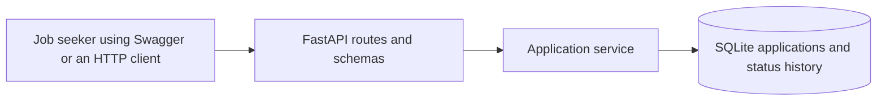

# Architecture and decisions

The first iteration is one HTTP service backed by a local SQLite file. FastAPI
validates input and exposes OpenAPI/Swagger; a small application service owns
business rules and write transactions; SQLAlchemy performs database access.

## Python and FastAPI

Python 3.12, FastAPI and Pydantic 2 give this API a small implementation and a
usable demonstration surface without building a client. Django would be a
reasonable choice for an application needing accounts and an administrative UI.
Those capabilities do not justify its additional setup for this iteration.
FastAPI's generated documentation is only useful when routes include meaningful
examples, so the workflow must also be described in the README.

## SQLite and schema changes

SQLite keeps local setup independent of a database server. SQLAlchemy 2 provides
explicit queries, transactions and a straightforward route toward PostgreSQL if
shared hosting becomes necessary. Alembic creates a versioned initial schema;
the API does not silently create or modify tables on startup. This adds one
setup command but makes an empty database and an existing database predictable.

Foreign keys are enabled on every connection. A database cascade deletes
history. Status changes and history insertion share one transaction. Short
transactions and a busy timeout suit local use; last-write-wins editing remains
a documented limitation. A future multi-user version needs ownership, conflict
handling and a reviewed database/deployment choice before becoming public.

## Synchronous request handling

Use ordinary `def` routes and synchronous SQLAlchemy sessions. Database access
is blocking, and there is no remote I/O that would justify an async database
driver. Each request receives its own session and cleans it up even on failure.
The application factory accepts a database URL so tests and runtime share the
same initialization path without touching the personal database.

The module boundaries are configuration, database lifecycle, models, request and
response schemas, application service, and HTTP routes. There is no generic
repository, CRUD superclass, event bus or background worker. History is an
ordinary child table, not an event-sourcing system.

## Dates, search and updates

Follow-ups use calendar dates. UTC is the documented default for today's date;
an explicit `as_of` makes reports repeatable and allows a local date to be used
without adding timezone settings. This may differ from the user's local date
near midnight. History timestamps still include UTC offsets.

SQLite's built-in case-insensitive search covers ASCII. Non-ASCII case folding
is not promised by this MVP. Literal wildcard escaping prevents a search for
`%` or `_` from unexpectedly matching everything. This limitation is preferable
to adding an extension solely for a personal application list.

PATCH merges changes before validating the action/date pair. Closing a record
preserves its next action for correction or reopening. All transitions are
allowed because these are user-maintained records, not a hiring system enforcing
a company's interview process.

## Delivery, safety and observability

The default URL is `sqlite:///./data/tracker.db`. Local Uvicorn binds to
127.0.0.1. Docker binds internally on all interfaces but publishes its port on
host loopback only; a named volume holds the SQLite file. The container runs as
a non-root user. uv and its lock file reproduce dependency resolution. CI runs
the same tests and lint checks used locally.

There is no authentication, open CORS configuration or remote URL fetching.
Requests may contain personal notes, so bodies and note values are not logged.
Health reads the application schema, returning a generic failure if the database
is unusable or migrations have not run. Console access/error logs are the only
observability infrastructure required at this scale.

## Verification approach

Contract tests exercise HTTP behavior against a temporary real SQLite database.
Targeted transaction tests inject a history-write failure. A separate HTTP test
starts a real Uvicorn process, performs the workflow, restarts it with the same
database and checks persistence. Migration tests create a fresh schema and
check that it agrees with the models. There is no arbitrary coverage target.

Implementation references:
- https://fastapi.tiangolo.com/tutorial/sql-databases/
- https://fastapi.tiangolo.com/advanced/testing-dependencies/
- https://docs.sqlalchemy.org/en/20/orm/session_basics.html
- https://alembic.sqlalchemy.org/en/latest/tutorial.html
